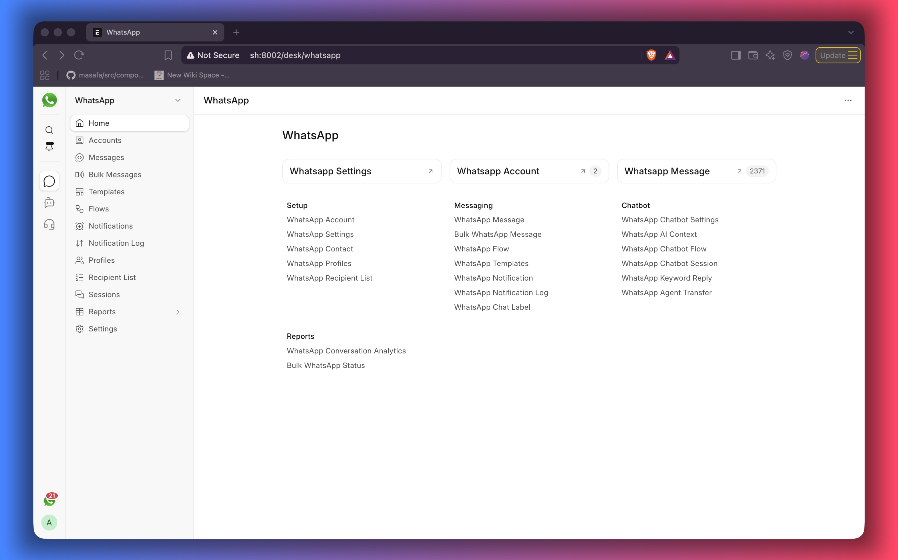

# WhatsApp Suite — User Guide

WhatsApp Suite brings your WhatsApp Business conversations into the same system you already use for
customers, sales and support. This guide explains what you can do — no technical knowledge needed.

## What you can do

- **Chat with customers** in a WhatsApp-style screen: send messages, photos, documents and templates.
- **Keep conversations organised** with labels, pins, stars and an archive.
- **Switch between business accounts** if your company has more than one WhatsApp number.
- **Send bulk messages** to saved recipient lists using approved templates.
- **Reply automatically** with a chatbot, keyword replies and optional AI answers.
- **Send WhatsApp alerts automatically** when records such as invoices or leads change.
- **See what is working** with campaign and conversation reports.

## The guide

1. [Getting started](getting-started.md) — sign in and find your way around
2. [The chat portal](chat-portal.md) — the chat list, labels, pins, stars and archiving
3. [Conversations](conversations.md) — sending messages and the 24-hour rule
4. [Bulk messaging](bulk-messaging.md) — recipient lists and campaigns
5. [Templates and flows](templates-and-flows.md) — pre-approved messages and in-chat forms
6. [Chatbot and AI replies](chatbot-and-ai.md) — automatic answers and handing over to a person
7. [Automatic notifications](notifications.md) — send a WhatsApp message when something happens
8. [Reports](reports.md) — campaign results and conversation activity
9. [WhatsApp in Desk](desk.md) — the workspace, message list and **Send To Whatsapp**
10. [Administration](administration.md) — connecting accounts, users and settings
11. [Setting up on the Meta side](meta-setup.md) — business portfolio, number, app, token and webhook
12. [Questions and fixes](faq.md) — common problems and what to do

## Who does what

| If you are…                             | Start with                                   |
| --------------------------------------- | -------------------------------------------- |
| An agent or team member answering chats | [Getting started](getting-started.md)        |
| A team lead organising conversations    | [The chat portal](chat-portal.md)            |
| Someone running promotions or reminders | [Bulk messaging](bulk-messaging.md)          |
| The person who sets the account up      | [Administration](administration.md)          |
| The person dealing with Meta            | [Setting up on the Meta side](meta-setup.md) |

---
