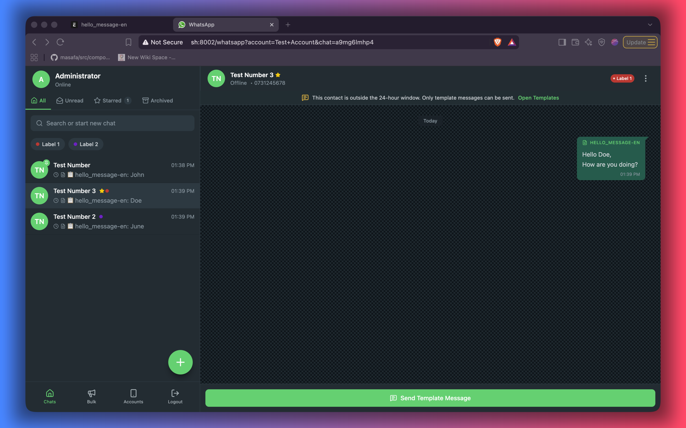

# The chat portal

The chat portal is your main workspace. It looks and feels like WhatsApp, with extra tools for
teams: labels, pins, stars, an archive and more than one business account.

## Finding a chat

Type part of a name or phone number in the search box. The list narrows as you type.

Above the list are four tabs:

| Tab          | Shows                                           |
| ------------ | ----------------------------------------------- |
| **All**      | Every chat except archived ones                 |
| **Unread**   | Chats with new messages you have not opened yet |
| **Starred**  | Chats you have starred as important             |
| **Archived** | Chats you have put away                         |

The number beside a tab tells you how many chats are waiting in it.

Chats are ordered by the most recent message, but pinned chats always stay at the top.

## Pinning a chat

Pin the conversations you use every day — a VIP customer, a supplier, your own test number.

Open the chat, click the menu at the top right and choose **Pin**. A pin marker appears next to the
chat and it moves to the top of the list. Choose **Unpin** to undo it. Pinning affects only your own
view; your colleagues' lists are unchanged.

## Starring a chat

Starring is for chats you want to come back to later. Open the chat menu and choose **Star**. A star
appears on the chat and it can be found in the **Starred** tab. Choose **Unstar** to remove it.

A simple way to use them together: pin what you are working on now, star what you need to revisit.

## Archiving a chat

When a conversation is finished, open the chat menu and choose **Archive**. The chat disappears from
**All** and moves to **Archived**, so the main list stays focused. Nothing is deleted: the whole history
stays with the chat, and any new message lands there too.

To bring it back, open the **Archived** tab, open the chat and choose **Unarchive**.

## Labels

Labels are coloured tags that describe a conversation — for example _Order_, _Payment_, _Complaint_ or
_VIP_. An administrator decides which labels exist; you decide which ones apply to each chat.

**Add labels to a chat**

1. Open the chat and click the menu at the top right.
2. Choose **Add labels** (or **Labels** if some are already applied).
3. Tick one or more labels, then save.

The labels appear as small coloured tags in the chat header.

**Filter the chat list by label**

Under the tabs you will see the available labels as small buttons. Click one or more of them to show
only chats carrying those labels. If you select several, chats with **any** of the selected labels are
shown. Click the **✕ All** button to clear the label filters.

Labels and tabs work together: for example, the **Unread** tab with the _Payment_ label shows only
unread payment chats.

Labels are shared with the whole team, so they are a good way to agree who is handling what. Pins,
stars and archive are personal — each person organises their own view.

## Switching accounts

If your company has several WhatsApp numbers, the bottom bar shows an **Accounts** shortcut. Choose a
number to switch. The chat list, templates, bulk messages and labels then apply to that account.

## New messages and unread counts

- Unread chats are highlighted and show a count of new messages.
- Opening a chat marks its messages as read, and the customer sees the usual blue ticks if that
  setting is enabled for the account.
- Notifications for new messages depend on your browser and system settings; keep the portal open in
  a tab if you want them.

## Starting a new chat

Press the floating **+** button, enter the customer's name and number and start writing. Remember the
24-hour rule: if the person has not written to you yet, you can only open the conversation with an
approved template — see [Conversations](conversations.md#the-24-hour-rule).

---
